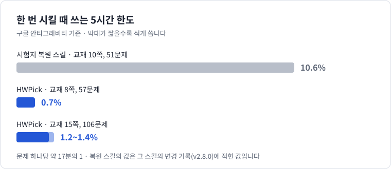
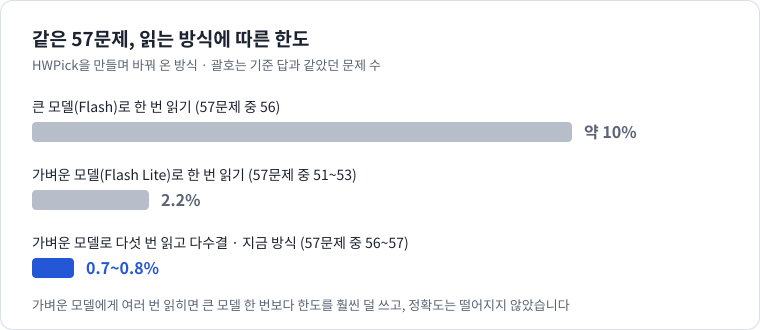

# HWPick — 교재에서 고른 문제만 한글 문서로

스캔한 수학 교재 PDF에서 **원하는 문제만 골라** 편집 가능한 한글(HWP) 문서로 만들어 주는 구글 안티그래비티(Antigravity)용 스킬입니다. "2단원 문제만 모아 줘"처럼 말로 시키거나, 화면에서 문제를 클릭해 고릅니다.

시험지 한 부를 통째로 복원하려면 [hwp-exam-restoration](https://github.com/acb0808/hwp-exam-restoration)을 쓰세요.

## 왜 이 스킬을 쓰나요

- **한도를 아주 적게 씁니다.** 문제를 읽는 일을 안티그래비티의 가장 가벼운 모델(Flash Lite)에게 맡깁니다. 교재 8쪽에서 57문제를 옮기는 데 5시간 한도의 **0.7%**쯤 들었습니다. 시험지 복원 스킬과 견주면 문제 하나당 **약 17분의 1**입니다.
- **고칠 수 있는 문서가 나옵니다.** 글은 글자로, 수식은 한글 수식으로 들어가서 숫자 하나만 바꾸는 것도 됩니다.
- **도형은 원본 화질 그대로 들어갑니다.** 다시 그리지 않고 교재에서 잘라 붙입니다.

## 한도와 시간





57문제는 5~7분, 106문제는 8~16분 걸렸습니다. Google AI Pro 요금제의 안티그래비티에서 제작자가 한두 번씩 잰 값이라 요금제와 그날의 상태에 따라 달라집니다. 복원 스킬은 쪽 배치와 정답표까지 되살리는 더 큰 일을 하므로, 이 비교는 교재에서 문제를 옮기는 일에 한한 것입니다.

## 설치

안티그래비티를 열고 아래 문장을 그대로 붙여 넣으세요. 에이전트가 알아서 설치합니다.

```text
https://github.com/acb0808/hwp-problem-picker 스킬(HWPick)을 설치해 주세요.
저는 코딩을 모릅니다. 저장소의 AGENT_INSTALL.md를 먼저 읽고 그 순서대로 진행해 주세요.
다른 스킬과 설정은 건드리지 말고, 제가 직접 해야 하는 일이 있으면 쉬운 말로 알려 주세요.
끝나면 설치 점검 결과를 알려 주세요.
```

에이전트가 "이 명령을 실행해도 될까요?"라고 물으면 허용해 주세요. 끝나면 **안티그래비티를 껐다 다시 켭니다.**

준비물과 업데이트 방법은 [준비물과 업데이트](docs/SETUP.md)에 있습니다.

## 사용법

교재 PDF를 폴더 하나에 모아 두고 안티그래비티에서 그 폴더를 엽니다. 요청에는 **"HWPick"이라는 말을 꼭 넣어 주세요.**

**말로 시키기**

```text
HWPick 스킬로 (교재 이름)에서 2단원 문제만 모아서 한글 파일로 정리해 줘
```

```text
HWPick 스킬로 이 교재의 60쪽부터 63쪽까지 문제를 전부 한글 파일로 만들어 줘
```

```text
HWPick 스킬로 이 교재에서 0412번부터 0440번까지만 뽑아 줘
```

**화면에서 클릭해 고르기**

```text
HWPick 스킬로 문제 선택 화면을 열어 줘
```

브라우저에 열린 화면에서 문제를 클릭해 담고, `에이전트에 전달`을 눌러 복사된 문구를 안티그래비티에 붙여 넣습니다.

**만든 뒤에 고치기**

```text
HWPick으로 방금 만든 목록에서 7번이랑 12번은 빼고 다시 만들어 줘
```

```text
HWPick으로 아까 만든 한글 파일에서 3번, 5번, 7번부터 10번까지만 뽑아서 새 파일로 만들어 줘
```

다 만들면 에이전트가 파일 위치와 함께 **확인이 필요한 문제 번호**(읽은 결과가 서로 달랐던 문제, 그림을 잘라 붙인 문제, 그림이 빠진 문제)를 알려 줍니다. 그 번호만 직접 확인하면 됩니다.

## 알아 둘 한계

- 가는 선으로만 된 그림은 자동으로 찾지 못할 때가 있습니다. "그림이 빠졌다"고 알려 주니 직접 넣어 주세요.
- 그림이 맞게 잘렸는지는 자동으로 확인하지 않습니다.
- 조사 한 글자(을/를, 이/가)가 원문과 다르게 들어갈 때가 드물게 있습니다.
- 문제 번호 모양이 특이한 교재는 문제 자리를 잘 찾지 못할 수 있습니다. 그럴 때는 선택 화면의 `직접 그리기`를 씁니다.
- 교재 몇 권으로만 확인했습니다. 한 번에 100문제 안팎씩 시키는 것을 권합니다.
- 해설과 정답은 옮기지 않습니다. 윈도우에서만 됩니다.

## 문제가 생겼을 때

에이전트에게 `HWPick 설치 상태를 점검해 줘`라고 말해 보세요. 그래도 안 되면 [이슈](https://github.com/acb0808/hwp-problem-picker/issues)에 오류 내용을 적어 주세요. 교재 내용이나 개인 정보는 올리지 마세요.

## 더 보기

- [준비물과 업데이트](docs/SETUP.md)
- [저작권 안내](docs/COPYRIGHT.md)
- [MIT 라이선스](LICENSE) · [출처 안내](THIRD_PARTY_NOTICES.md)
